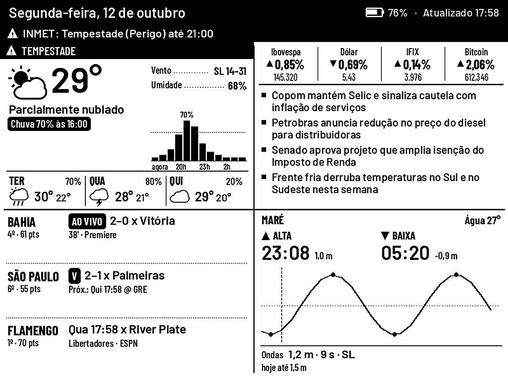
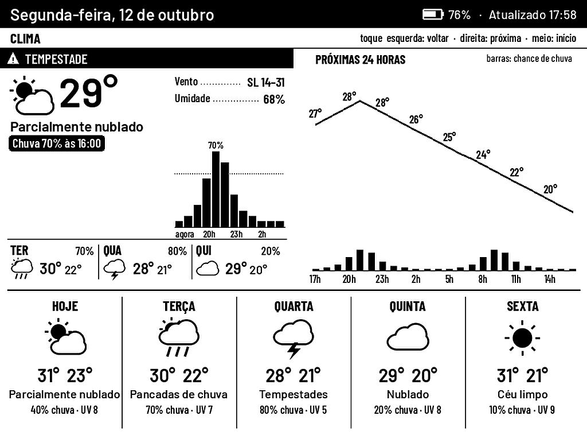
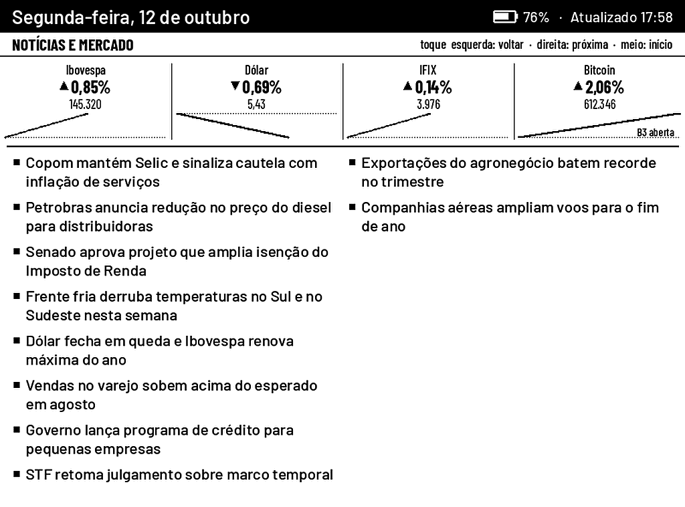
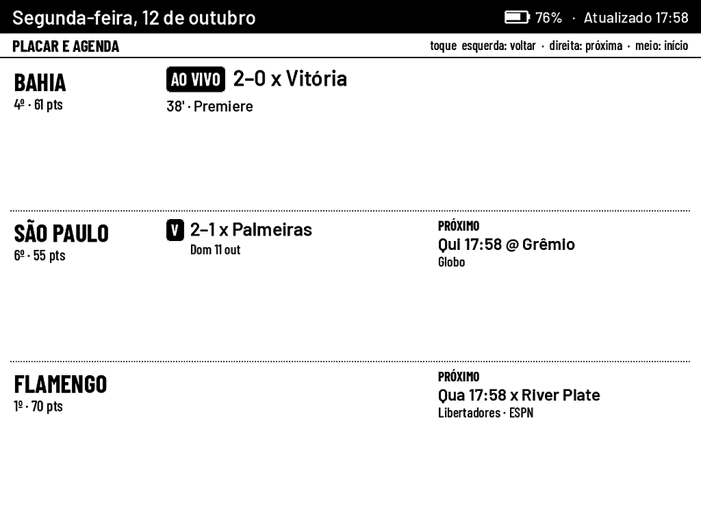
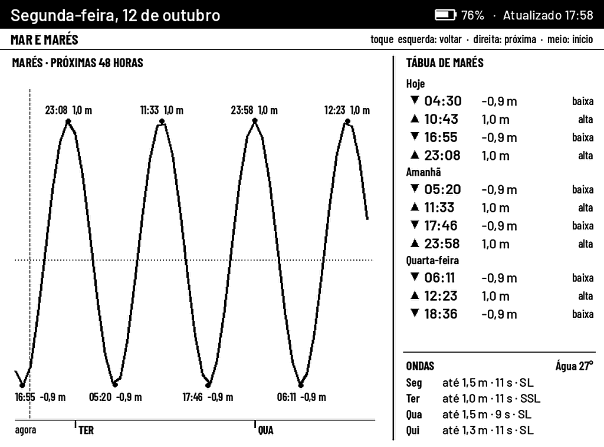

# Quad Board para Kindle Paperwhite

Um Kindle Paperwhite antigo, com jailbreak, vira um painel de cozinha: deitado de lado, ele mostra num relance o clima de Salvador, as notícias e o mercado, os jogos do Brasileirão e a maré. Tudo em 16 tons de cinza, atualizando sozinho e trocando de página com um toque.



## O que aparece

| Canto | Mostra |
|---|---|
| **Clima** | condição atual, chance de chuva nas próximas horas, previsão de 3 dias, aviso de chuva para os próximos minutos e alertas oficiais do **INMET** |
| **Notícias e mercado** | manchetes do **g1** e da **Agência Brasil** (Folha e BBC News Brasil opcionais), mais **Ibovespa, dólar, IFIX e bitcoin** com minigráfico do dia |
| **Times** | **Bahia**, **São Paulo** e o **G4** do Brasileirão ao vivo: placar, último resultado, próximo jogo (Libertadores, Sul-Americana e Copa do Brasil inclusive), posição e pontos |
| **Mar** | próxima maré alta e baixa, curva da maré, ondas e temperatura da água. Passagens visíveis da ISS e lançamentos de foguete tomam o canto quando acontecem |

Logo abaixo da data, uma faixa traz uma linha: o seu recado fixado, um alerta severo do INMET ou um resumo do dia escrito pelo **Claude** (opcional). A interface toda está em português, com °C, relógio de 24 h e números no formato brasileiro.

Cada canto tem uma página de detalhe:

| | |
|---|---|
|  |  |
|  |  |

### Toque

Com o Kindle deitado:

| Toque | Faz |
|---|---|
| terço **esquerdo** | página anterior |
| terço **direito** | próxima página |
| **meio** | volta ao quadro inicial (no quadro, atualiza tudo) |
| **segurar 3 s** | sai e devolve a interface do Kindle |

## Como funciona

```
Kindle (KUAL + script busybox)                   servidor (Python, no CasaOS)
  pergunta: "mudou alguma coisa?"  ───────────▶  espera até a próxima versão
                                   ◀───────────  "versão 13, sem piscar"
  baixa o PNG 758×1024 pronto     ───────────▶  desenha tudo com Pillow
  mostra com FBInk / eips

  toque ─▶ manda as coordenadas   ───────────▶  decide a zona e troca a página
```

O Kindle não decide nada: o servidor desenha cada pixel, já girado e em 16 tons de cinza, e o Kindle só baixa a imagem e mostra. Mudar layout, fontes de dados ou frequência é sempre uma configuração no dashboard do servidor, nunca uma mexida no Kindle.

- **Na tomada:** o Kindle fica acordado e os toques respondem em 1–2 s.
- **Na bateria:** ele acorda logo depois de cada atualização (a cada 10 min), fica uns 25 s aceitando toques e volta a dormir.
- **Piscadas:** a tela pisca para limpar fantasmas só ao iniciar e a cada 8 atualizações; o resto é atualização parcial, sem piscar.

## Montando

Você precisa de:

- um **Kindle Paperwhite de 1ª geração** (2012) com **jailbreak** e **KUAL** (o FBInk é opcional, já que o `eips` do próprio Kindle também serve);
- uma máquina **sempre ligada** na rede de casa para o servidor. Aqui é um ZimaBoard com **CasaOS**, mas qualquer Docker ou Python 3.10+ serve.

Os passos:

1. **Servidor:** siga o [`CASAOS.md`](CASAOS.md). Ele cobre o Docker, o `.env` com os tokens, o dashboard, o resumo do Claude e como manter o Docker no SSD.
2. **Kindle:** siga o [`kindle/README.md`](kindle/README.md). Ele cobre copiar a extensão do KUAL, configurar o `quad.conf`, o Start, a calibração do toque, o início automático no boot e o diagnóstico.

Sem Docker, o servidor também roda direto:

```sh
cd server
pip install -r requirements.txt
cp quad.env.example quad.env       # defina QUAD_TOKEN e QUAD_ADMIN
set -a; . ./quad.env; set +a
QUAD_BIND=0.0.0.0 python app.py    # porta 8740
```

## Dashboard

Abra `http://<servidor>:8740/?k=<QUAD_ADMIN>` em qualquer navegador da rede. Lá ficam:

- **Prévia ao vivo:** o que o Kindle está mostrando agora, e o status dele (bateria, USB, último toque).
- **Configurações:** localização, unidades, idioma, relógio, times, feeds de notícias, cotações, conteúdo do canto do mar ou dos aviões, frequências, rotação da tela e eixos do toque.
- **Recado fixo:** um texto que aparece na faixa de cima.
- **Health:** a situação de cada fonte de dados, com o erro quando alguma falha.

Os padrões já vêm para Salvador:

| Configuração | Padrão |
|---|---|
| Localização | Salvador, BA (código IBGE 2927408, para os alertas do INMET) |
| Unidades / relógio / idioma / números | °C e km/h / 24 h / português / `1.234,56` |
| Times | `bahia`, `sao_paulo`, `g4` (os 4 primeiros da tabela, ao vivo) |
| Notícias | g1, g1 Economia, Agência Brasil |
| Cotações | `^BVSP`, `BRL=X`, `IFIX.SA`, `BTC-BRL` |
| Canto do céu | `sea` (maré e ondas); `planes` traz de volta o radar de aviões |

Para outro time, acrescente no `config.json` com o id da ESPN, que aparece na URL do clube em espn.com.br. Por exemplo, `"custom_teams": {"flamengo": ["Flamengo", "soccer", "bra.1", "819"]}`, e depois `flamengo` na lista `teams`.

**Prévia sem hardware:** `cd server && python kindle_cases.py` gera todas as telas do Kindle com dados de exemplo (`kindle_*.png`); com `--docs`, atualiza também as imagens deste README. Nos exemplos, o Bahia está sempre ganhando o Ba-Vi.

## Fontes de dados

Todas são gratuitas e sem chave:

- **Clima:** [Open-Meteo](https://open-meteo.com) (previsão e chuva para os próximos minutos); alertas do [INMET](https://alertas2.inmet.gov.br).
- **Mar:** Open-Meteo Marine. As marés vêm de um modelo oceânico: servem para saber quando a maré está alta, mas não para navegação.
- **Notícias:** RSS do g1, da Agência Brasil, da Folha e da BBC News Brasil.
- **Cotações:** Yahoo Finance.
- **Futebol:** API pública da ESPN (com os nomes e as notícias da ESPN Brasil).
- **Céu:** CelesTrak (passagens da ISS) e Launch Library 2 (lançamentos). Para o radar de aviões opcional, adsb.lol e adsb.fi, que hoje não cobrem Salvador.
- **Resumo do dia:** o [Claude Code](https://code.claude.com) dentro do container, com a sua assinatura (`CLAUDE_CODE_OAUTH_TOKEN`). Sem token, fica desligado.

## Estrutura

```
server/    Python: fontes de dados, renderização, servidor de long-poll, dashboard
kindle/    extensão do KUAL + script busybox do Kindle (e o guia de instalação)
firmware/  firmware do Seeed reTerminal E1001, do projeto original
docs/      imagens
```

## Projeto original

Este repositório é uma adaptação do **[eink-quad](https://github.com/j-rod-ay/eink-quad)**, de [j-rod-ay](https://github.com/j-rod-ay), um painel de cozinha feito para a tela e-paper **Seeed reTerminal E1001** (7,5″, ESP32-S3), com clima, notícias do WSJ, times de Tampa e os aviões que passam sobre a casa ([página do projeto](https://j-rod-ay.github.io/eink-quad/)). Toda a base vem de lá: o servidor que desenha cada pixel, o protocolo de long-poll, os painéis e o dashboard.

Aqui foram acrescentados o Kindle Paperwhite como tela, a localização para o Brasil (INMET, Brasileirão, notícias e mercado brasileiros, português, °C e 24 h), o painel do mar e o empacotamento em Docker para o CasaOS. O suporte ao E1001 continua no código (`firmware/` e o layout de 800×480), e as opções originais (WSJ, times americanos, °F, inglês, aviões) seguem disponíveis no dashboard.

## Licença

MIT, como o original. As fontes incluídas têm licenças próprias, listadas em [`server/fonts/LICENSES.md`](server/fonts/LICENSES.md).
