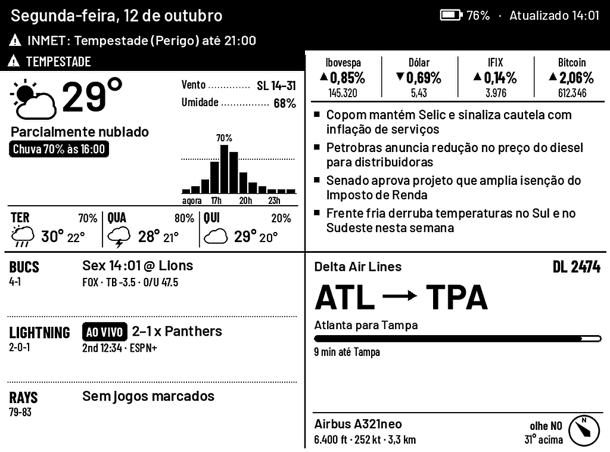

# Quad Board no Kindle Paperwhite (1ª geração, com jailbreak)

O mesmo painel, num Kindle Paperwhite original (PW1, 2012) deitado em paisagem. O servidor desenha tudo em **16 tons de cinza** a 1024×758 e já gira a imagem para o framebuffer de 758×1024. O Kindle só baixa o PNG e mostra.



| Toque | Faz |
|---|---|
| terço **esquerdo** da tela | página anterior |
| terço **direito** | próxima página |
| **meio** | volta ao quad (no quad, atualiza tudo) |
| **segurar 3 s** em qualquer lugar | sai e volta para a interface do Kindle |

## Como funciona

```
Kindle (quad.sh, busybox)                     servidor (app.py)
  GET /api/kindle/poll?v=12&wait=50   ──────▶  segura até a versão mudar
                                      ◀──────  "13 0 0"  (versão, piscar?, dormir N s)
  GET /api/kindle/frame.png           ──────▶  PNG 758×1024, 16 cinzas
  fbink/eips -g frame.png

  toque  ─▶ GET /api/kindle/tap?x=..&y=..  ─▶  mapeia para esquerda/meio/direita
                                               e muda a página (a versão sobe,
                                               o long-poll acima volta na hora)
```

- **Na USB:** fica acordado, com long-poll, e os toques respondem em ~1–2 s.
- **Na bateria:** acorda pelo RTC logo depois de cada atualização agendada (a cada `interval_min`, padrão 10 min), desenha, fica acordado `AWAKE_S` segundos para aceitar toques (cada toque estende a janela) e volta a dormir. Dá para desligar isso no dashboard ("On battery, sleep between scheduled updates"), mas aí a bateria dura bem menos.
- A tela pisca (atualização completa) ao iniciar e a cada 8 atualizações, ou quando você clica em "Full refresh" no dashboard. O resto é atualização parcial em 16 cinzas, sem piscar.

## O que você precisa

1. **Jailbreak** no PW1 e o **KUAL** instalado ([MobileRead: Kindle Developer's Corner](https://www.mobileread.com/forums/forumdisplay.php?f=150)).
2. Opcional, mas recomendado: **FBInk** (do NiLuJe). Se o KOReader estiver instalado, ele já vem junto. Sem FBInk, o script usa o `eips` do sistema, que também funciona.
3. O **servidor** deste repositório rodando numa máquina da rede local (Raspberry Pi, NAS…). Veja o [README principal](../README.md#server).

## Instalação

### 1. Servidor

**No CasaOS:** siga o [`CASAOS.md`](../CASAOS.md). O container já escuta na rede local, na porta 8740, e você pode pular o resto desta seção.

O firmware do PW1 tem `wget`/OpenSSL antigos que não falam TLS moderno, então o Kindle usa **HTTP puro na rede local**. Faça o servidor escutar na LAN:

```sh
cd server
export QUAD_BIND=0.0.0.0 QUAD_TOKEN=um-token-qualquer QUAD_ADMIN=outro-token
python app.py
```

(Se o servidor já fica atrás de nginx/Caddy com HTTPS para o E1001, basta abrir também uma porta HTTP só para a LAN.)

Abra `http://<servidor>:8740/?k=<QUAD_ADMIN>`. O card **Kindle Paperwhite** no dashboard mostra a prévia do que o Kindle vai exibir, o status (bateria, USB, último toque) e as configurações.

### 2. Kindle

1. Ligue o Kindle no computador e copie a pasta `kindle/extensions/quadboard` para `extensions/` na raiz do Kindle, ficando `/mnt/us/extensions/quadboard/`.
2. Lá dentro, copie `quad.conf.example` para `quad.conf` e preencha `SERVER` e `TOKEN`.
3. Ejete o Kindle, abra o **KUAL** e escolha **Quad Board → Start**.

A interface do Kindle some e o painel aparece. Para sair, segure o dedo na tela por 3 s (ou KUAL → Stop, via SSH: `sh /mnt/us/extensions/quadboard/bin/quad.sh stop`).

### 3. Acertar a orientação e o toque

- **Imagem de cabeça para baixo?** No dashboard, mude **Which way it lies** (90° = porta USB à esquerda, 270° = à direita).
- **Toques do lado errado?** Rode **KUAL → Quad Board → Touch test**. Por 30 s, toque à esquerda, no meio e à direita (com o Kindle deitado). Cada toque aparece no dashboard como `x,y -> left/middle/right`. Se sair trocado, ajuste **Touch axes** (Flip X / Flip Y) e teste de novo.

## Dicas e limitações

- **Use um carregador de tomada, não o computador.** Ligado a um PC, o Kindle entra em modo pen-drive e desmonta `/mnt/us`. O script roda de uma cópia em `/var/tmp` para não cair, mas os logs e a configuração ficam inacessíveis até desconectar.
- **Botão liga/desliga:** com o painel rodando, apertar o botão faz o Kindle dormir do jeito dele. Melhor não usar; para sair, segure o dedo na tela.
- **Toques na bateria:** enquanto o Kindle dorme, a tela de toque não funciona. Ele só responde na janela de `AWAKE_S` segundos depois de cada atualização. Para usar o toque à vontade, deixe-o na USB.
- **Log:** `/mnt/us/extensions/quadboard/quad.log` (dá para ler pelo USB). `quad.sh status` mostra as últimas linhas.
- **Testado** em simulação (busybox `sh`/`wget`/`hexdump`/`awk`, eventos de toque sintéticos e um servidor local). Os comandos do Kindle (`lipc`, `eips`, RTC, Wi-Fi) seguem o que KOReader e kindle-dash usam no PW1, mas ainda não rodaram num aparelho real. Se algo falhar, o `quad.log` diz onde.

## Configuração (`quad.conf`)

| Variável | Padrão | |
|---|---|---|
| `SERVER` | | `http://IP:8740` do servidor |
| `TOKEN` | | o `QUAD_TOKEN` do servidor |
| `POWER` | `auto` | `auto` detecta USB pelo `isCharging` (ou bateria em 100%); `usb` / `battery` forçam |
| `AWAKE_S` | `25` | na bateria, segundos acordado depois de acordar ou de um toque |
| `HOLD_S` | `3` | segundos segurando para sair |
| `GIVEUP_S` | `60` | se o servidor não responder nesse tempo depois do Start, o painel desiste e devolve a interface do Kindle (`0` = tenta para sempre) |
| `TOUCH_DEV` | auto | por exemplo `/dev/input/event1`, se a detecção errar |
| `RTC` | auto | `rtc1` se existir, senão `rtc0` |

No servidor (dashboard ou `config.json`): `kindle_rotate`, `kindle_touch_flip`, `kindle_battery_sleep`, `kindle_full_every`.

Para ver todas as telas do Kindle sem hardware nem rede: `cd server && python kindle_cases.py` gera `kindle_*.png`.
