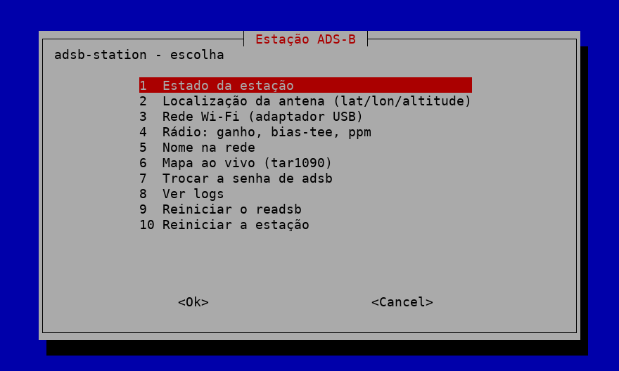
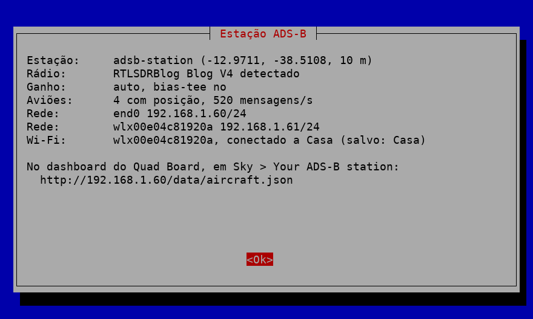
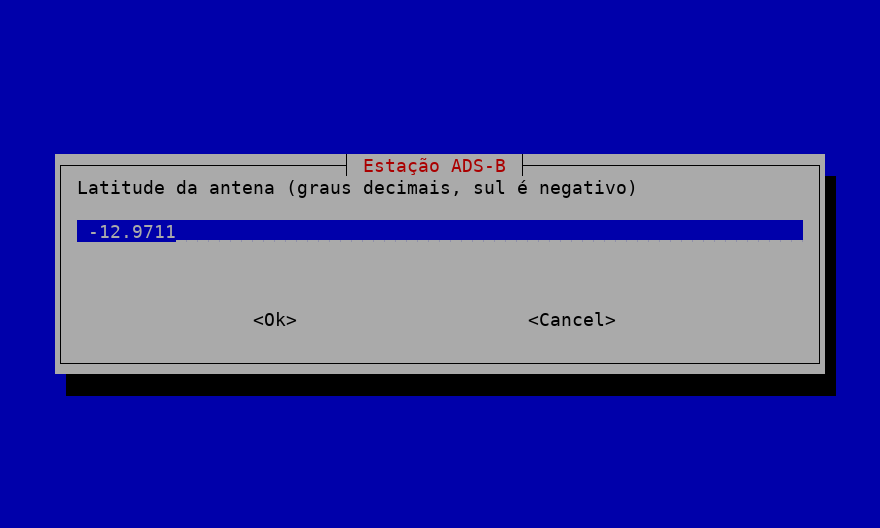
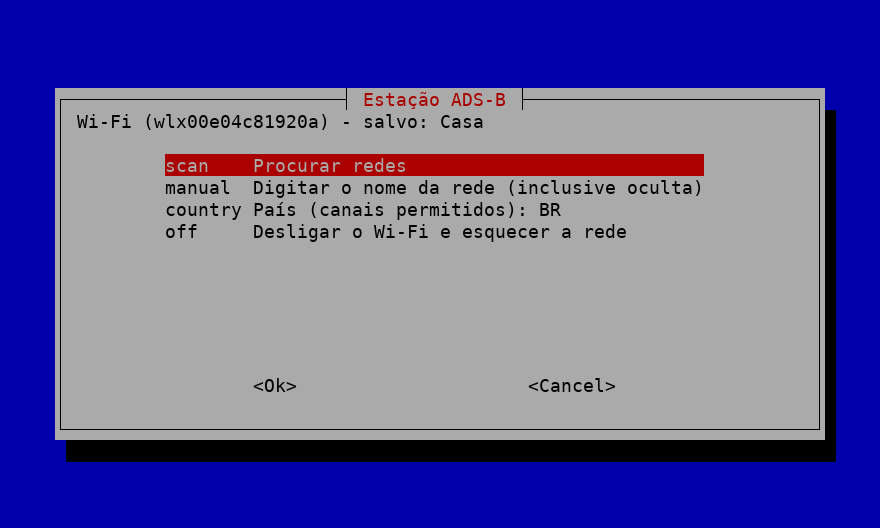
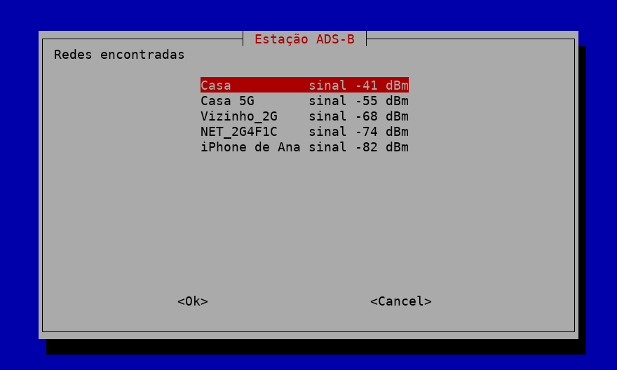
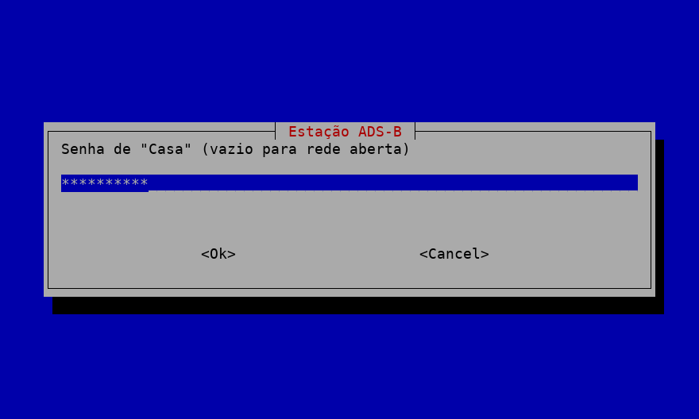
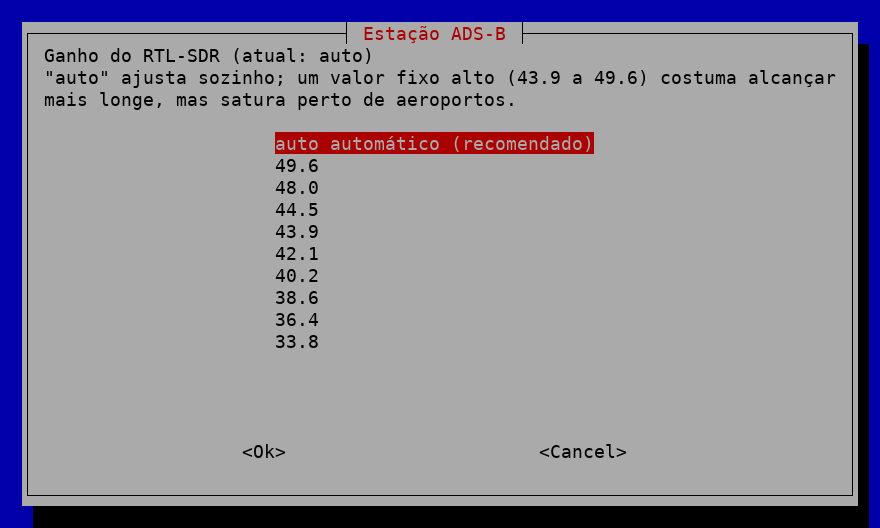
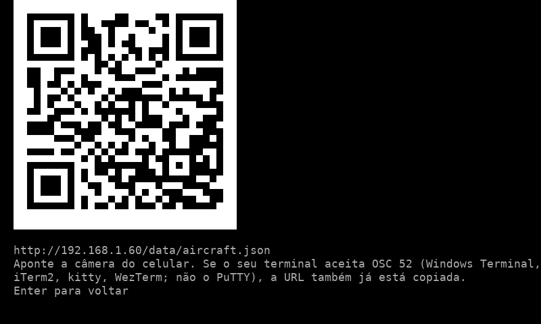
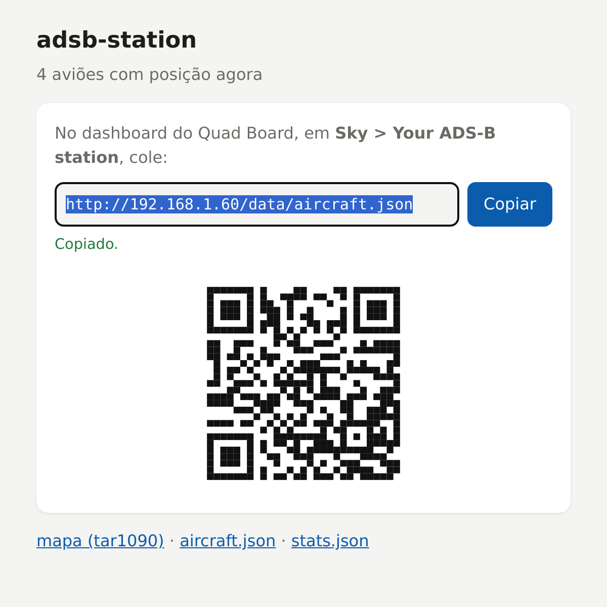

# Estação ADS-B (Le Potato + RTL-SDR)

Uma estação própria de rastreio de aviões para o canto do céu do Quad Board. Ela vê os aviões que passam sobre Salvador, onde as redes públicas (adsb.lol, adsb.fi) quase não têm receptores.

- **Placa:** Libre Computer **Le Potato** (AML-S905X-CC), com rede cabeada
- **Rádio:** **RTL-SDR Blog V4** (serve qualquer RTL-SDR) e uma antena de 1090 MHz
- **Software:** Debian 12 oficial da Libre Computer, mais o driver do RTL-SDR Blog (com suporte ao V4), o [readsb](https://github.com/wiedehopf/readsb) e, opcional, o mapa [tar1090](https://github.com/wiedehopf/tar1090)

```
antena ─ RTL-SDR V4 ─ Le Potato (readsb) ── http://<estação>/data/aircraft.json
                                                   ▲
                       servidor do Quad Board ─────┘  junta com adsb.lol / adsb.fi
                                                       e desenha o canto do céu
```

O servidor busca os dados na estação; a estação não precisa saber do servidor.

## 1. Gerar a imagem

Num Linux (ou WSL2, ou no próprio CasaOS), como root:

```sh
sudo apt install btrfs-progs mtools xz-utils fdisk git curl
sudo station/build-image.sh            # saída em station/work/out/
```

O script não monta nada nem roda código arm64: ele baixa a imagem oficial (e confere o SHA-256), lê a partição btrfs, acrescenta os arquivos da estação e reescreve a partição com o mesmo UUID. Também põe dentro da imagem os pacotes `.deb` que faltam e o código-fonte do driver e do readsb, nos commits fixados em [`sources.lock`](sources.lock). Assim, o primeiro boot funciona sem internet.

Variável opcional: `ROOT_MB` define o tamanho da partição na imagem (padrão: 3072). No primeiro boot, ela cresce até ocupar o cartão inteiro.

## 2. Gravar e configurar

1. Grave o `adsb-station-lepotato-AAAAMMDD.img.xz` num cartão de 8 GB ou mais, com o [balenaEtcher](https://etcher.balena.io) ou o Raspberry Pi Imager ("usar imagem personalizada").
2. Tire e recoloque o cartão no computador. Na partição **boot** (FAT, abre no Windows), edite o `adsb-station.conf`:
   - `PASSWORD` e/ou `SSH_PUBKEY`: sem pelo menos um dos dois, a estação se recusa a configurar;
   - `LAT`, `LON` e `ALT_M` da antena;
   - `HOSTNAME`, se quiser outro nome além de `adsb-station`;
   - `WIFI_SSID` e `WIFI_PSK`, se a estação for usar um adaptador Wi-Fi USB em vez do cabo;
   - `TAR1090=no`, se não quiser o [mapa](#mapa-tar1090) (o padrão é `yes`).
3. Ligue o cabo de rede (ou o adaptador Wi-Fi), o RTL-SDR e a fonte (5 V, 2 A ou mais). Para o mapa vir junto, a estação precisa de internet no primeiro boot.

## 3. Primeiro boot

A estação instala os pacotes, compila o driver e o readsb e reinicia. Leva uns 10 a 15 minutos. Com HDMI, dá para acompanhar o progresso na tela.

O log fica em `/var/log/adsb-firstboot.log` e também no próprio cartão, na partição boot (`adsb-firstboot.log`). Se algo falhar, dá para ler o log no PC, corrigir o `.conf` e religar. Ao terminar, a estação:

- apaga as senhas (usuário e Wi-Fi) do `adsb-station.conf`;
- cria o `adsb-firstboot.done`. Para refazer a configuração, apague esse arquivo e religue a placa;
- bloqueia o login do root (use o seu usuário com `sudo`).

Depois do reboot:

```sh
ssh adsb@adsb-station.local
systemctl status readsb
viewadsb                                   # tabela ao vivo no terminal (Ctrl+C sai)
curl -s localhost/data/aircraft.json | jq '.aircraft | length'
```

No navegador, `http://adsb-station.local/` abre a página da estação (veja [Ligar no servidor](#4-ligar-no-servidor)).

### Mapa (tar1090)

A estação tem um servidor web (lighttpd), que serve três coisas:

| Endereço | O que é | Quando existe |
|---|---|---|
| `/` | página da estação: aviões vistos agora, a URL para o Quad Board, botão Copiar e QR Code | sempre |
| `/data/aircraft.json`, `/data/stats.json` | os dados do readsb, que o servidor do Quad Board lê | sempre |
| `/tar1090/` | o mapa ao vivo dos aviões, com rastros, tabela e detalhes de cada voo | se o tar1090 foi instalado |

O resto vem dentro da imagem e funciona sem internet. O [tar1090](https://github.com/wiedehopf/tar1090) não vem: o primeiro boot roda o instalador oficial, que o baixa do GitHub com o banco de aeronaves. Por isso o mapa é opcional. Ele só é instalado com `TAR1090=yes` (o padrão) e internet no primeiro boot. O Quad Board não usa o mapa, então a estação funciona igual sem ele.

**Ele foi instalado?** A página `http://adsb-station.local/` mostra o link **mapa (tar1090)** quando o mapa existe. No log do primeiro boot, procure a linha `--- tar1090 map`: em seguida vem `no internet: tar1090 skipped` ou `tar1090 install failed`, se não deu certo.

**Instalar depois** (ou atualizar, que usa o mesmo comando), por SSH, com a estação na internet:

```sh
sudo bash -c "$(curl -fsSL https://raw.githubusercontent.com/wiedehopf/tar1090/master/install.sh)"
sudo systemctl start adsb-webpage     # a página da estação passa a mostrar o link do mapa
```

O instalador acha o lighttpd e os dados do readsb (`/run/readsb`) e publica o mapa só em `/tar1090/`, sem mexer na página da estação. Leva poucos minutos.

**Remover:**

```sh
sudo bash /usr/local/share/tar1090/uninstall.sh   # também reinicia o lighttpd
sudo systemctl start adsb-webpage                 # tira o link da página
```

## `adsb-config`: configurar depois

Para mudar alguma coisa depois do primeiro boot, entre por SSH (ou use teclado e HDMI) e rode:

```sh
sudo adsb-config
```

Abre um menu, no estilo do `omv-firstaid` do OpenMediaVault:



| Opção | Faz |
|---|---|
| Estado da estação | rádio detectado, readsb, aviões com posição, mensagens/s, IPs, Wi-Fi e a URL para colar no dashboard do servidor; o botão **QR / copiar URL** mostra um QR Code dessa URL e a copia para a área de transferência |
| Localização da antena | latitude, longitude e altitude; reinicia o readsb |
| Rede Wi-Fi | procura redes e conecta, aceita rede oculta digitando o nome, define o país dos canais, desliga |
| Rádio | ganho (auto ou fixo), bias-tee e correção em ppm |
| Nome na rede | muda o `<nome>.local` |
| Senha, logs, reiniciar | trocar a senha do usuário, ver os logs do readsb e do primeiro boot, reiniciar o readsb ou a placa |

| | |
|---|---|
|  |  |
|  |  |
|  |  |
|  | |

As telas são geradas a partir do menu real, com dados de exemplo (`python3 station/screens/capture.py`, como root, com `whiptail`, `jq` e `pip install pyte`). O script não altera nada na máquina.

As mesmas ações funcionam como comandos, o que serve para scripts:

```sh
adsb-config status                              # não precisa de sudo
adsb-config url                                 # a URL para o servidor; --qr mostra o QR Code
sudo adsb-config location -12.9711 -38.5108 10  # lat, lon, altitude (m)
sudo adsb-config wifi "Minha Rede" "senha123"   # --hidden para rede oculta
sudo adsb-config wifi-country BR
sudo adsb-config wifi-scan
sudo adsb-config wifi-off
sudo adsb-config radio 49.6 no                  # ganho, bias-tee [ppm]
sudo adsb-config hostname radar-casa
```

O `status` também aparece ao entrar por SSH.

Tudo fica em `/etc/adsb-station.conf`, e o `/etc/default/readsb` é gerado a partir dele. Edite pelo `adsb-config`, e não à mão.

### Wi-Fi por USB

A Le Potato não tem Wi-Fi na placa. Funcionam os adaptadores USB com driver no kernel da imagem (6.1), com o firmware já incluído:

- **Realtek:** `rtl8xxxu` (RTL8188CUS/EUS, RTL8192CU/EU), `r8188eu`, `rtw88` (RTL8821CU, RTL8822BU, RTL8723DU)
- **MediaTek / Ralink:** `mt7601u`, `mt76x0u`, `mt76x2u`, `mt7921u`, `rt2800usb`
- **Atheros:** `ath9k_htc` (AR9271), `carl9170`

O Wi-Fi usa o **iwd**, e o endereço vem por DHCP pelo systemd-networkd, como no cabo. As redes salvas ficam em `/var/lib/iwd/`, legíveis só pelo root. Com cabo e Wi-Fi ao mesmo tempo, o cabo tem preferência. Adaptadores que precisam de driver fora do kernel (vários RTL8812AU/RTL8811CU antigos, por exemplo) não funcionam sem compilar esse driver à parte.

## 4. Ligar no servidor

A URL que o servidor precisa aparece em três lugares, sempre com o **IP** da estação:

- **Na página da estação:** `http://adsb-station.local/` mostra a URL, um botão **Copiar** e um QR Code, além de quantos aviões ela vê agora. A página se atualiza sozinha se o IP mudar.
- **No terminal:** `sudo adsb-config`, em Estado, botão **QR / copiar URL**. Ele mostra o QR Code e copia a URL via OSC 52, que funciona por SSH no Windows Terminal, iTerm2, kitty e WezTerm (no PuTTY, não). `adsb-config url` só imprime a URL.
- **No fim do log do primeiro boot.**

Com o celular, aponte a câmera para o QR, toque e segure no link e escolha "copiar". Depois cole no dashboard do Quad Board.



No dashboard do Quad Board (`http://<servidor>:8740/?k=<QUAD_ADMIN>`), no card **Sky**:

- **Sky corner shows:** `Planes overhead (ADS-B)`
- **Your ADS-B station:** `http://<IP da estação>/data/aircraft.json`
- **Also merge the public networks:** deixe marcado para somar adsb.lol e adsb.fi

Use o **IP**, não `adsb-station.local`: o container do servidor normalmente não resolve nomes `.local`. Reserve o IP da estação no roteador (reserva de DHCP).

Outra opção é definir `QUAD_ADSB_LOCAL=http://<IP>/data/aircraft.json` no `.env` do servidor. Isso vale como padrão até alguém mudar o campo no dashboard.

A tabela **Health** do dashboard mostra, em "Plane networks", quantos aviões cada fonte vê dentro do raio (`station: 7 · adsb.lol: 2 ...`), ou o erro, se a estação não responder.

## Notas

- **RTL-SDR Blog V4:** o `librtlsdr` 0.6 do Debian não reconhece o V4. Por isso, o driver vem do [rtl-sdr-blog](https://github.com/rtlsdrblog/rtl-sdr-blog), instalado em `/usr/local`, e o driver DVB-T do kernel fica bloqueado (`/etc/modprobe.d/blacklist-rtl-sdr.conf`).
- **Bias-tee:** `BIAS_TEE=yes` alimenta um LNA ou filtro pelo cabo. Não ligue com uma antena em curto DC.
- **Portas** (para alimentar outras redes depois): Beast na 30005, SBS na 30003 e entrada Beast nas 30004/30104.
- **Atualizar o readsb ou o driver:** troque o commit no `sources.lock` e gere uma imagem nova. Na estação já em uso, compile à mão a partir do repositório.
